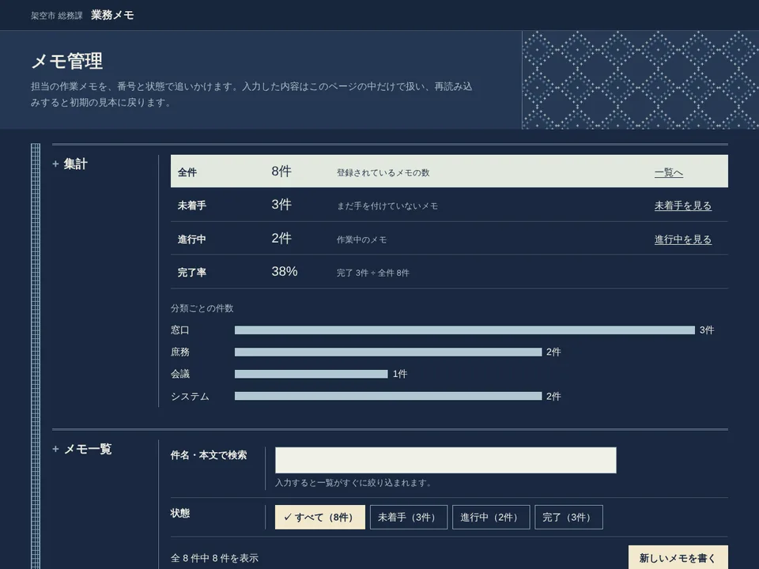
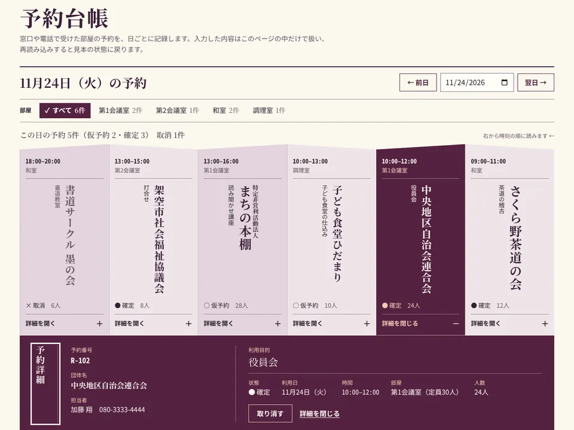
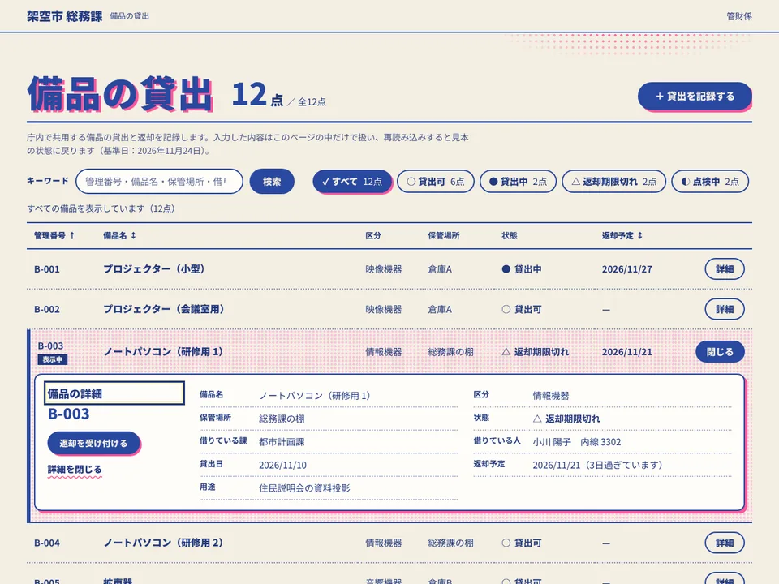
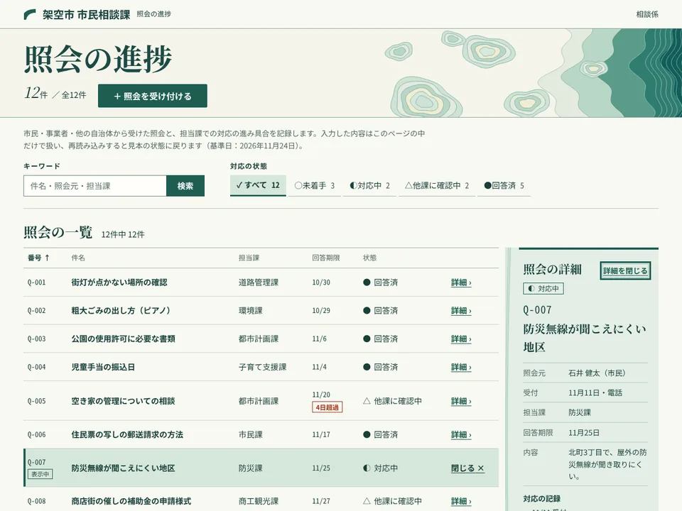
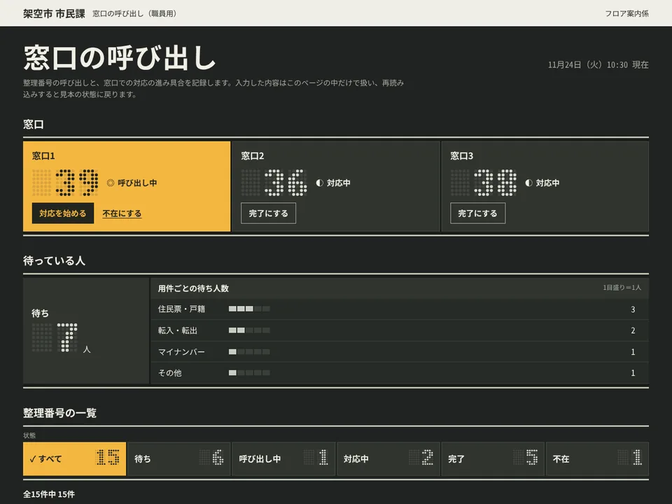

# design-skills

5つの独自 UI デザインを、AI エージェント（Claude Code、Codex など）に別の Web アプリへ適用させるための Agent Skill です。画面を見てデザインを選び、Skill のフォルダーを対象のアプリにコピーして使います（[導入する](#導入する)）。

5つとも、依頼の中で**デザインの名前を指定したときだけ**使う想定です。「ダークな UI に」「緑系の UI に」「印刷物風に」のような一般的な依頼では使いません。下の画像は、Skill を書いたときに別の業務へ当てはめた**適用見本**の画面で、実在のシステムの画面ではありません（データはすべて架空）。

## デザインを選ぶ

### 糸の交点 — [okinawa-thread-ui](skills/okinawa-thread-ui/SKILL.md)



- **特徴**：宮古上布に着想した濃藍の地に、本文左の格子帯、章の二重罫、「章｜項目名｜値」の縦の軸。
- **向く用途の例**：情報の一覧と整理、文書・メモの管理。
- **呼び方の例**：「糸の交点で」「沖縄テーマ（糸の交点）で」
- 見本：業務メモ（[検証記録](https://github.com/YanTKYS/design-lab/blob/main/examples/okinawa-thread-memo/VERIFICATION.md)）

### 折本（H′案） — [h-prime-ui](skills/h-prime-ui/SKILL.md)



- **特徴**：生成りと葡萄色、明朝の表題。縦組みの面を右から左へ読み、フォームは右頁→左頁の見開き。狭い幅では横組みに切り替える。
- **向く用途の例**：少数の一覧（1日の予約など）、2つのまとまりを並べて入力するフォーム、台帳。
- **呼び方の例**：「折本で」「H′で」
- 見本：部屋の予約台帳（[検証記録](https://github.com/YanTKYS/design-lab/blob/main/examples/h-prime-room-booking/VERIFICATION.md)）

### 二色刷り（J案） — [j-risograph-ui](skills/j-risograph-ui/SKILL.md)



- **特徴**：青の版（文字・罫・操作）と蛍光ピンクの版（版ずれ・網点・影の飾りと選択の地）の二版。エラーは青の反転札と二重罫で、ピンクは使わない。
- **向く用途の例**：個性を持たせたい一覧・台帳、住民向けの案内や申込。
- **呼び方の例**：「二色刷りで」「J案で」
- 見本：備品の貸出台帳（[検証記録](https://github.com/YanTKYS/design-lab/blob/main/examples/j-risograph-equipment-lending/VERIFICATION.md)）

### 汀線（K案） — [k-shoreline-ui](skills/k-shoreline-ui/SKILL.md)



- **特徴**：淡い緑の面で関連を示し、曲線（汀線）で領域のつながりと境目を見せる。選んだ行から続く詳細、章名の陸と入力欄の水際。
- **向く用途の例**：一覧から1件を選んで詳細を読む画面、申請・照会の管理。
- **呼び方の例**：「汀線で」「K案で」
- 見本：照会の進捗（[検証記録](https://github.com/YanTKYS/design-lab/blob/main/examples/k-shoreline-inquiry-tracker/VERIFICATION.md)）

### 標示盤（L案） — [l-signage-ui](skills/l-signage-ui/SKILL.md)



- **特徴**：暗い盤面を区画に分け、今の状態だけを琥珀で点灯させる。件数などを 5×7 のドット文字で点灯させてもよい（任意の装飾。数値は普通の文字で読める。時計のように数値そのものを読ませる表示では使わなくてよい）。件数を扱う画面では1目盛り＝1件の点灯。
- **向く用途の例**：状態の表示、進捗・窓口の管理、手順のある入力。
- **呼び方の例**：「標示盤で」「L案で」
- 見本：窓口の呼び出し（[検証記録](https://github.com/YanTKYS/design-lab/blob/main/examples/l-signage-counter-queue/VERIFICATION.md)）

5つのデザインの元になった申請管理の画面（一覧・フォーム・ダッシュボード）は、design-lab の[比較サイト](https://yantkys.github.io/design-lab/)で、ほかの公開デザインシステムと並べて見比べられます。

依頼の例：

```text
この画面（src/pages/memo.html）を「糸の交点」の見た目に改修してください。
保存・検証の処理は変えないでください。375px と 1280px で崩れないか確認してください。
```

```text
窓口の呼び出し画面（src/counter/）を「標示盤」（L案）の見た目にしてください。
呼び出し・保存・権限は変えないでください。琥珀は呼び出し中の窓口と選んだ状態だけにし、
ドット文字の件数と読み上げる文字の件数が同じか、強制カラーでも選択が分かるか確認してください。
```

## このリポジトリと design-lab の役割

| リポジトリ | 役割 |
| --- | --- |
| **design-skills**（ここ） | 配布する Skill の**正本**。Skill の更新はここで行う |
| [design-lab](https://github.com/YanTKYS/design-lab) | 13デザインの調査・比較サイト（[公開ページ](https://yantkys.github.io/design-lab/)）と、Skill を作ったときの固定の適用見本・検証記録の正本 |

Skill の元になったデザインと、Skill を作ったときの見本は design-lab にあります。形式は [Agent Skills の仕様](https://agentskills.io/specification)（`SKILL.md` と任意の `references/`・`assets/`）に合わせています。

## 導入する

Skill は**使うアプリのリポジトリ（またはユーザーの設定フォルダー）にコピーしたときだけ**読み込まれます。このリポジトリが GitHub にあるだけでは、エージェントがほかのリポジトリの作業で自動的に使うことはありません。

使う Skill のフォルダーを、`references/`・`assets/`・`LICENSE` を含めて**丸ごと**コピーします（シンボリックリンクは不要です。Windows でもエクスプローラーでのコピーで足ります）。

| エージェント | 対象のリポジトリだけで使う | 自分の全リポジトリで使う |
| --- | --- | --- |
| Claude Code | `<アプリのリポジトリ>/.claude/skills/<Skill 名>/` | `~/.claude/skills/<Skill 名>/` |
| Codex | `<アプリのリポジトリ>/.agents/skills/<Skill 名>/` | `~/.agents/skills/<Skill 名>/` |

コマンドでコピーする場合（Bash。アプリのリポジトリの直下で実行）。書き換えるのは `src=` の1行だけです。`$HOME/projects/design-skills` は仮の置き場所なので、このリポジトリを clone した場所に、`h-prime-ui` は使う Skill 名に変えます。引用符で囲んであるので、パスに空白があってもそのまま動きます。

Claude Code の場合：

```bash
# この1行だけ、実際に clone した場所と使う Skill 名に変える
src="$HOME/projects/design-skills/skills/h-prime-ui"
mkdir -p .claude/skills
cp -R "$src" .claude/skills/
```

Codex の場合（コピー先だけが違う）：

```bash
# この1行だけ、実際に clone した場所と使う Skill 名に変える
src="$HOME/projects/design-skills/skills/h-prime-ui"
mkdir -p .agents/skills
cp -R "$src" .agents/skills/
```

Windows の PowerShell でコピーする場合（アプリのリポジトリの直下で。`$src` はこのリポジトリの Skill のフォルダー、`$dest` はコピー先の `skills` フォルダー。パスに空白があっても、引用符で囲めばそのまま使えます）：

```powershell
$src  = "$env:USERPROFILE\Documents\design skills\skills\h-prime-ui"   # このリポジトリを置いた場所に合わせる
$dest = ".claude\skills"                                                # Codex は ".agents\skills"
New-Item -ItemType Directory -Force -Path $dest | Out-Null
Copy-Item -Path $src -Destination $dest -Recurse -Force
```

- `-Destination` には Skill 名のフォルダーではなく、その親の `skills` フォルダーを指定します。`.claude\skills\h-prime-ui` を直接指定すると、そのフォルダーが既にあるときに `h-prime-ui\h-prime-ui` と二重になります。
- 自分の全リポジトリで使う場合は、`$dest` を `"$env:USERPROFILE\.claude\skills"`（Codex は `"$env:USERPROFILE\.agents\skills"`）にします。
- 更新するときの扱いは、下の「[Skill を更新するとき](#skill-を更新するとき)」を見てください。

コピー後の構成（例）：

```text
.claude/skills/h-prime-ui/     （Codex は .agents/skills/h-prime-ui/）
├── SKILL.md
├── LICENSE                    （MIT License。消さずに残す）
├── references/
│   ├── design-principles.md
│   └── patterns.md
└── assets/
    └── tokens.css
```

各 Skill の `assets/` に入っているもの：

| Skill | assets |
| --- | --- |
| okinawa-thread-ui | `tokens.css`、`thread-pattern.svg`（見出しの模様） |
| h-prime-ui | `tokens.css` |
| j-risograph-ui | `tokens.css` |
| k-shoreline-ui | `tokens.css`、`k-shore.svg`（表題の等高線） |
| l-signage-ui | `tokens.css`、`dot-digits.js`（5×7 のドット文字を描く小さな関数） |

### Skill を更新するとき

- 基本は、上と同じコマンドでコピー先の同じフォルダーへ**上書き**します。
- 上書きの前に、コピー先で独自に変えたファイル（`tokens.css` の値、`SKILL.md` の追記など）がないかを確かめ、あれば退避しておきます。コピーした側で値を変えた場合は、どちらを正とするかを対象リポジトリの設計メモなどに書いておきます。
- 上書きでは、新しい版でなくなったファイルがコピー先に残ります。古いファイルを残したくない場合に限り、独自の変更を退避したうえで、コピー先の Skill 名のフォルダー（例：`.claude/skills/h-prime-ui`、PowerShell では `.claude\skills\h-prime-ui`）を削除してからコピーします。

### 既存のアプリに試すとき

既存のアプリに適用するときの進め方です（各 `SKILL.md` の手順にも短く書いてあります）。

- 依頼がない限り、**現行のデザインを標準のまま残し**、Skill を選べる追加のテーマとして試します（明示的に置き換えを頼む場合や、新しいアプリは別）。依頼していないテーマの切替機能は、エージェントに勝手に作らせません。
- テーマの切替を頼む場合は、標準を初期値にし、選んだテーマの保存、既存の明暗の配色モード、データ・主要操作・URL を保ち、テーマの CSS の範囲を分けるよう伝えます。
- Skill のコードや素材を取り込んだら、MIT の著作権表示と許諾文の全文を、アプリの配布物にも残します（1つの HTML ならコメント、静的サイトなら配布するファイルなど）。アプリ全体のライセンスは変えません。
- Skill の部品をすべて入れることより、アプリの目的・読みやすさ・操作のしやすさを優先します。既存の機能にない部品は足さず、使わなかった部品とその理由を報告してもらいます。

### 版（バージョン）

- 配布版は、リポジトリ全体で1つの版番号とタグ（例：`v0.2.0`）で示します。各 `SKILL.md` の `metadata.version`（例：`"0.2.0"`）は、そのタグの版と同じです。フォルダーだけをコピーした後も、コピー先の `SKILL.md` で、どの版から取ったかが分かります。
- 決まった版を取るときは、[Releases](https://github.com/YanTKYS/design-skills/releases) から入手するか、タグを指定して clone します（`v0.2.0` は使う版に読み替え）。

```bash
git clone --branch v0.2.0 https://github.com/YanTKYS/design-skills.git
```

- 版番号は、取った配布版の目安です。コピー先で変えた内容が配布版と同じであることや、新しい版が出たことの通知までは保証しません。
- 版ごとの変更は [CHANGELOG.md](CHANGELOG.md) にまとめます。この README と各 Skill の文書は今の使い方と仕様だけを書き、変更の経緯は CHANGELOG、詳しい議論と確認の記録は Issue・プルリクエストに残します。

## 検証の状況

### 確かめたこと

- **Agent Skills の形式**（[scripts/validate-skills.py](scripts/validate-skills.py)。プルリクエストと `main` への push のたびに GitHub Actions で実行）：`skills/` にある Skill をフォルダーごと一時フォルダーへ1つずつコピーし、`SKILL.md` の frontmatter が実際の YAML パーサー（PyYAML）で読めること、`name` とフォルダー名の一致・`name` の文字種・`description` の長さなどの仕様上の制約、`references/`・`assets/` への相対リンクと本文で挙げたアセットが Skill のフォルダーの中に実在すること、フォルダーの中の `LICENSE` がリポジトリ直下の `LICENSE` と同じ内容で、frontmatter の `license` が `MIT` であること。あわせて、この README の「デザインを選ぶ」に載せた Skill と `skills/` のフォルダーが過不足なく一致すること（フォルダーだけ追加して掲載を忘れた場合、掲載したままフォルダーを消した場合はエラー）。手元では `pip install -r scripts/requirements.txt` のあと `python scripts/validate-skills.py` で同じ検査ができます（`scripts/` と `.github/` は検査用で、Skill のフォルダーにはコピーしません）。
- **独立したセッションでの適用（5つとも）**：Skill を書いたのとは別のセッションが、Skill をデザインの資料として適用した例です（どれもマージ済み）。どれも依頼の中で Skill を渡して（名指しして）読ませたもので、エージェントが Skill を自動で見つけて選ぶかの検証ではありません。どの画面・エージェント・ブラウザでも同じように適用できることを保証するものでもありません。

  | Skill | 適用先 | エージェント | 適用の形 |
  | --- | --- | --- | --- |
  | okinawa-thread-ui | [markdown-library PR #11](https://github.com/YanTKYS/markdown-library/pull/11)、[okinawa-watch PR #12](https://github.com/YanTKYS/okinawa-watch/pull/12) | Codex | アプリの見た目に適用 |
  | j-risograph-ui | [kanban PR #18](https://github.com/YanTKYS/kanban/pull/18) | Mistral Vibe Code | **試験用のファイル**（`iKanbanPilot.html`）の追加のテーマ。実用版のアプリ全体ではない |
  | h-prime-ui | [since PR #9](https://github.com/YanTKYS/since/pull/9) | Mistral Vibe Code（v0.1.0） | 標準のテーマを残し、選べる追加のテーマ |
  | k-shoreline-ui | [devlog PR #32](https://github.com/YanTKYS/devlog/pull/32) | Mistral Vibe Code（v0.1.0） | 標準のテーマを残し、選べる追加のテーマ |
  | l-signage-ui | [clock PR #35](https://github.com/YanTKYS/clock/pull/35) | Mistral Vibe Code（v0.1.0） | 標準のテーマを残し、選べる追加のテーマ |

  採用した部品・使わなかった部品とその理由は、それぞれの PR に書いてあります。
- **Skill を書いた本人による適用見本（5つとも）**：Skill を書いた同じ作業の中で、比較サイトにない別の業務に当てはめた見本です。作り手が原本の実装を知っているため、**独立した適用の評価ではありません**。見本と検証記録は design-lab にあります。

| Skill | 見本（design-lab） | 検証記録 |
| --- | --- | --- |
| okinawa-thread-ui | 業務メモ | [VERIFICATION.md](https://github.com/YanTKYS/design-lab/blob/main/examples/okinawa-thread-memo/VERIFICATION.md) |
| h-prime-ui | 部屋の予約台帳 | [VERIFICATION.md](https://github.com/YanTKYS/design-lab/blob/main/examples/h-prime-room-booking/VERIFICATION.md) |
| j-risograph-ui | 備品の貸出台帳 | [VERIFICATION.md](https://github.com/YanTKYS/design-lab/blob/main/examples/j-risograph-equipment-lending/VERIFICATION.md) |
| k-shoreline-ui | 照会の進捗 | [VERIFICATION.md](https://github.com/YanTKYS/design-lab/blob/main/examples/k-shoreline-inquiry-tracker/VERIFICATION.md) |
| l-signage-ui | 窓口の呼び出し | [VERIFICATION.md](https://github.com/YanTKYS/design-lab/blob/main/examples/l-signage-counter-queue/VERIFICATION.md) |

### まだ確かめていないこと

- 独立した適用は、5つとも1〜2件ずつで、Codex と Mistral Vibe Code の2つのエージェントによるものです。ほかのエージェント・ほかの種類の画面での再現性は確かめていません。`j-risograph-ui` は試験用のファイル1つへの適用だけで、実用のアプリ全体への適用はしていません。
- Claude Code・Codex で、セッションの開始時に Skill が自動で認識され、依頼に応じて選ばれること。
- スクリーンリーダー、実機の IME、Chromium 以外のブラウザ、実際の OS の強制カラーなど、実機での確認。

## 変更を提案する

- `SKILL.md`・`references/`・`assets/` など **Skill 本体の修正は、このリポジトリ（design-skills）** に Issue またはプルリクエストで送ってください。比較サイトと、Skill を作ったときの固定の見本・検証記録は [design-lab](https://github.com/YanTKYS/design-lab) にあります。
- プルリクエストの前に、少なくとも次を実行して通ることを確かめてください（Python 3）：`pip install -r scripts/requirements.txt` のあと `python scripts/validate-skills.py`。
- 見た目や操作の不具合を報告するときは、Skill 名・画面の幅・再現の手順（できればブラウザー名も）を添えてください。

## 注意

- 5つはいずれも design-lab で作った**独自のデザイン**（名称は仮称）です。公式のデザインシステム、伝統工芸・実在の印刷物・地図・表示器の再現ではありません。
- Skill に入っているのは、色・書体・罫のトークンと規則、最小の例、小さな自作の素材だけです。design-lab の比較サイトの CSS・HTML・JavaScript は含まず、対象アプリの仕組みに合わせて書く前提です。
- 模様・等高線・ドット文字の字形は、第三者の素材を含まない自作のものです。
- README の画像（`docs/images/`）は、design-lab の適用見本の画面写真を切り取って縮小したものです。

## ライセンス

- このリポジトリのファイル（5つの Skill、その中の自作のアセット、README などの文書と画像、検査用のスクリプト）は [MIT License](LICENSE) です。
- 商用での利用、改変、複製、再配布、販売（改変したものを含む）ができます。その際は、著作権表示と許諾文（`LICENSE` の全文）を残してください。無保証です。
- 各 Skill のフォルダーにも同じ `LICENSE` を入れてあります。上の「導入する」のとおりフォルダーごとコピーすれば、許諾文も一緒に入ります。`SKILL.md` の frontmatter にも `license: MIT` と書いてあります。
- 元の Skill（正本）は [YanTKYS/design-skills](https://github.com/YanTKYS/design-skills) です。更新はここで行います。
- この許諾は、このリポジトリのファイルだけに及びます。[design-lab](https://github.com/YanTKYS/design-lab) の比較サイト・見本、比較サイトで並べている公開デザインシステムの素材には及びません（それぞれの許諾条件に従います）。

リポジトリの説明文・Topics・共有用の画像（Social preview）の設定方法は [docs/repository-settings.md](docs/repository-settings.md) にあります（リポジトリの管理者向け）。
